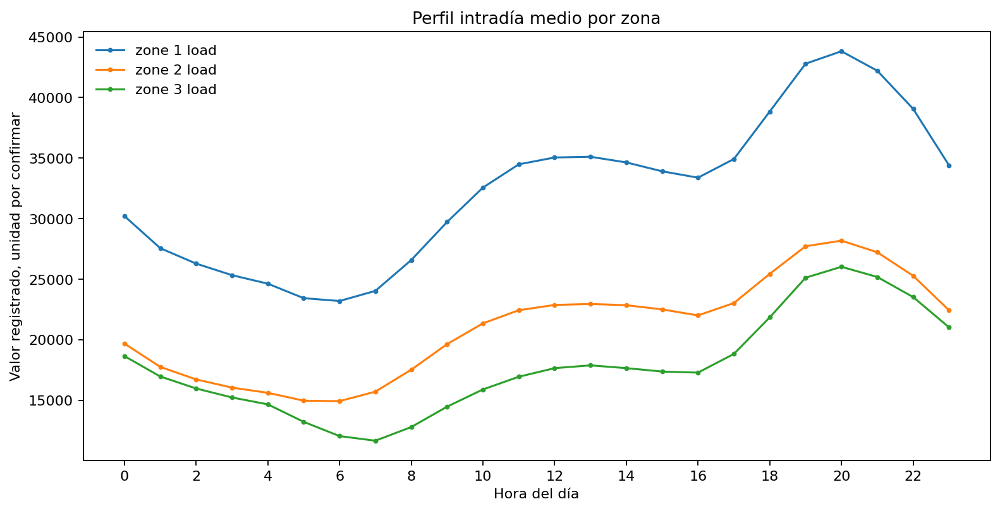
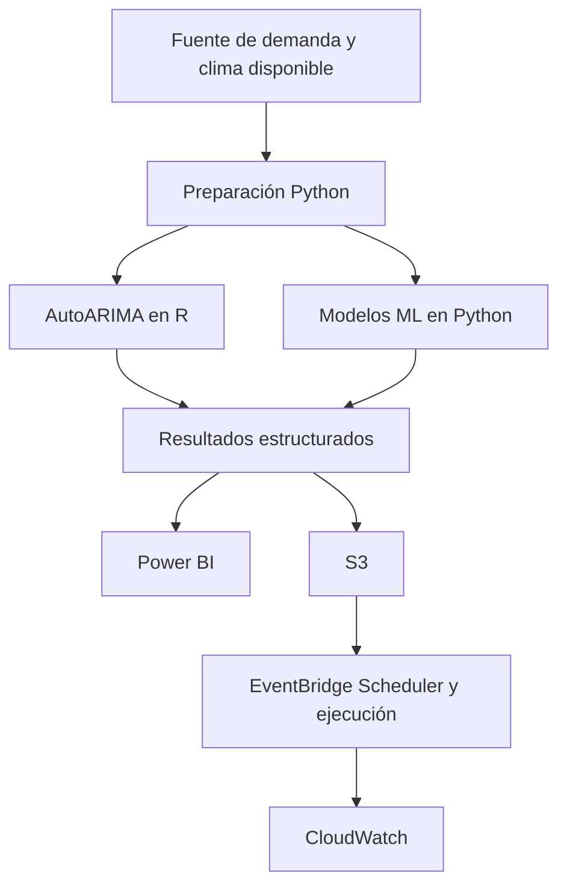

# Energy demand intelligence

Prototipo reproducible para pronosticar la carga eléctrica horaria de tres zonas de Tétouan, Marruecos, y detectar periodos de demanda estadísticamente elevada. El proyecto combina series temporales, machine learning, evaluación cronológica, automatización y visualización.

> **Alcance actual**  El histórico disponible corresponde a 2017. Los resultados representan una evaluación retrospectiva y no un servicio de pronóstico operativo para la demanda actual.

## Pregunta de negocio

¿Hasta qué punto los registros históricos de las tres zonas permiten pronosticar la carga a 24 horas y siete días, detectar periodos de demanda estadísticamente elevada y determinar si los modelos temporales o las variables explicativas aportan valor frente a referencias sencillas?

## Método

El trabajo se organiza con PMI para la dirección del proyecto y CRISP-DM para el desarrollo analítico. El análisis se documenta en un único notebook maestro. Las fases pueden iterarse cuando los resultados lo requieran.

| Fase | Trabajo | Estado |
|---|---|---|
| Business Understanding | Caso de negocio, objetivos, decisiones y criterios de éxito. | Definida |
| Data Understanding | Auditoría, calidad, perfiles e insights. | EDA inicial realizado |
| Data Preparation | Agregación horaria candidata y particiones temporales. | Provisional. Unidades por confirmar |
| Modeling | Baselines y candidatos iniciales de ML. AutoARIMA en R está planificado. | En desarrollo |
| Evaluation | Comparación inicial y evaluación histórica ya inspeccionada. | Parcial |
| Deployment | Pipeline local, Power BI y AWS. | Pendiente |

## Diseño analítico

### Pronóstico

Se compararán naive de persistencia, naive estacional diario y semanal, AutoARIMA mediante `forecast::auto.arima()` en R y modelos de regresión con machine learning en Python. Todos los candidatos se evaluarán por zona y horizonte sobre los mismos orígenes temporales.

### Demanda estadísticamente elevada

Se evaluará un clasificador separado. El umbral se calculará por zona usando únicamente los datos de entrenamiento. La etiqueta indicará un valor alto respecto al histórico y no una sobrecarga ni un límite técnico de la red.

### Evaluación

Para forecasting se utilizarán MAE, RMSE y WAPE. Para clasificación se considerarán precision, recall, F1, PR-AUC y falsas alarmas. La validación temporal evitará utilizar información futura.

El test de diciembre de 2017 ya fue inspeccionado en una evaluación anterior. Por eso no se tratará como holdout intacto para seleccionar AutoARIMA. La comparación nueva se apoyará en un diseño rolling-origin común y esta limitación quedará reportada.

## Datos

Fuente principal [Power Consumption of Tetouan City](https://archive.ics.uci.edu/dataset/849/power+consumption+of+tetouan+city), UCI Machine Learning Repository, DOI [10.24432/C5B034](https://doi.org/10.24432/C5B034), licencia CC BY 4.0.

El archivo local contiene 52.416 observaciones de diez minutos entre el 1 de enero y el 30 de diciembre de 2017. Falta el último día del año respecto a la cobertura calendario esperada. UCI no documenta la unidad física en su ficha. La serie horaria se mantiene como candidata hasta confirmar el significado de la variable.

## Exploración inicial

El perfil intradiario muestra patrones diarios distintos entre las tres zonas. La unidad física permanece pendiente de confirmación.



## Arquitectura objetivo



AWS se implementará después de validar el pipeline local y confirmar la fuente de demanda. Una actualización meteorológica no sustituye una actualización de consumo eléctrico.

## Estructura

```text
energy-demand-intelligence/
├── README.md
├── requirements.txt
├── data/
│   ├── raw/
│   └── processed/
├── notebooks/
│   └── Energy_Demand_Intelligence.ipynb
├── src/
│   ├── python/
│   └── r/
├── outputs/
│   ├── forecasts/
│   └── powerbi/
├── reports/
│   ├── figures/
│   └── tables/
├── powerbi/
├── docs/
└── .github/
```

## Reproducibilidad

1. Instalar Python y Git. Instalar R para ejecutar AutoARIMA.
2. Crear y activar el entorno virtual `.venv`.
3. Instalar las dependencias de `requirements.txt`.
4. Abrir `notebooks/Energy_Demand_Intelligence.ipynb` y seleccionar el kernel del proyecto.
5. Ejecutar las celdas en orden desde un kernel limpio.

La guía de instalación está en `docs/Getting_Started_Windows.md`. El plan de gestión está en `docs/Project_Management_Plan.md`.

## Documentación

- [Plan de dirección del proyecto](docs/Project_Management_Plan.md)
- [Configuración inicial en Windows](docs/Getting_Started_Windows.md)
- [Metodología CRISP-DM y notebooks](docs/CRISP_DM_and_Notebooks.md)
- [Brief del proyecto en PDF](docs/Energy_Demand_Intelligence_Brief.pdf)

## Presentación en GitHub

El repositorio documentará decisiones, método, resultados, estructura, pasos de ejecución, limitaciones y referencias. Los cambios relevantes se desarrollarán en ramas y se integrarán mediante Pull Requests revisados. Antes de hacerlo público se deberá definir la licencia del código y comprobar la atribución de los datos.

## Autor

Juan Camilo Sánchez Navarro
